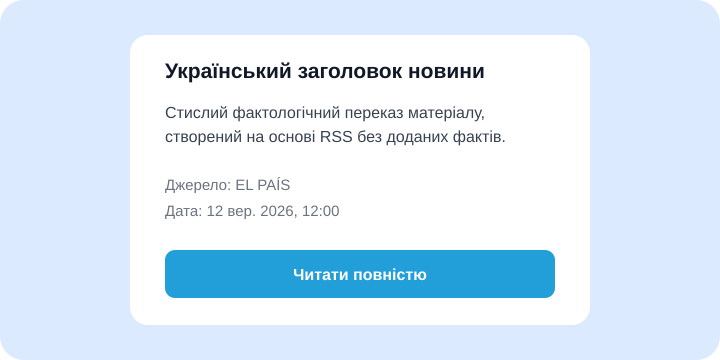
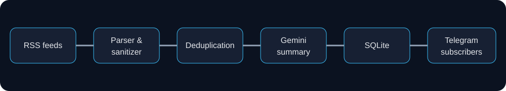

# News Bot

[](https://github.com/MykhailoLoniak/news-bot/actions/workflows/ci.yml)
[](https://github.com/MykhailoLoniak/news-bot/actions/workflows/codeql.yml)

A privacy-conscious multi-user Telegram bot that collects trusted RSS news, produces grounded Ukrainian summaries with Gemini, and delivers them to subscribers.



## Architecture



RSS feeds → parser and sanitizer → deduplication → Gemini translation and summary → SQLite → Telegram subscribers.

The application uses dependency-oriented modules under `bot/`, `services/`, `repositories/`, `jobs/`, and `utils/`. Importing `src/index.js` does not start Telegram polling; startup only happens when it is the executable entry point.

## Features

- Independent subscriptions with `/subscribe`, `/unsubscribe`, `/status`, and data deletion.
- Resilient multi-source RSS polling with HTML sanitization, retries, timeouts, and canonical URLs.
- One structured Gemini request per article with schema validation and safe fallback.
- SQLite migrations, delivery deduplication, integrity checks, backups, and corruption recovery.
- Safe Telegram HTML, inline article buttons, media fallback, command throttling, and message limits.

## Stack

Node.js 24, Telegraf, Gemini `@google/genai`, Cheerio, RSS Parser, SQLite, Zod, Vitest, ESLint, Prettier, GitHub Actions, CodeQL, Gitleaks, and Docker.

## Local setup

```bash
nvm use
npm ci
cp .env.example .env
npm start
```

| Variable                     | Required | Description                                     |
| ---------------------------- | -------- | ----------------------------------------------- |
| `TELEGRAM_BOT_TOKEN`         | Yes      | BotFather token                                 |
| `GEMINI_API_KEY`             | Yes      | Google AI Studio key                            |
| `GEMINI_MODEL`               | Yes      | Flash model, e.g. `gemini-2.5-flash`            |
| `RSS_SOURCES_JSON`           | No       | Array of source name, language, and URL objects |
| `RSS_CHECK_INTERVAL_MINUTES` | No       | Poll interval, default 15                       |
| `MAX_ARTICLES_PER_CYCLE`     | No       | Per-cycle cap, default 10                       |
| `DATABASE_PATH`              | No       | Absolute or relative SQLite path                |
| `LOG_LEVEL`                  | No       | debug, info, warn, or error                     |

Example Gemini output:

```json
{ "title": "Український заголовок", "summary": "Стислий переказ без доданих фактів." }
```

Example Telegram message:

> **Український заголовок**  
> Стислий переказ.  
> **Source:** EL PAÍS  
> **Date:** 12 Sep 2026, 12:00  
> [Read full article]

If Gemini times out, is rate-limited, returns a temporary 5xx, or violates the response schema, the bot uses the sanitized original title and text. Free-tier Gemini inputs may be used by Google to improve its products; only public RSS content is sent, never Telegram IDs.

## Architecture decisions

- SQLite keeps deployment inexpensive while transactions and delivery records prevent duplicates.
- Structured output plus runtime validation limits model ambiguity.
- A single polling job processes each article once before fan-out.
- Polling is intentionally single-instance; run one replica against the persistent volume.

## Verification

```bash
npm run lint
npm run format:check
npm test
npm run test:coverage
npm audit
```

## Deployment

Build with `docker build -t news-bot .`. Run one replica as a non-root user, inject secrets through the platform secret manager, and mount a persistent volume at `/app/data`. Suitable low-cost platforms include Fly.io, Render, Railway, or a small VPS; confirm current pricing before choosing. Configure automatic restart and external heartbeat/log monitoring. Never place secrets in the image or workflow.

## What I learned

Reliable AI delivery depends more on deterministic boundaries—schemas, retries, idempotency, sanitization, and persistence—than on the prompt alone.

## Future improvements

- TypeScript migration and generated database types.
- Distributed polling lease for safe horizontal scaling.
- Per-user languages and source preferences.
- Metrics endpoint and OpenTelemetry.

See [README.uk.md](README.uk.md), [CONTRIBUTING.md](CONTRIBUTING.md), and [CHANGELOG.md](CHANGELOG.md).
